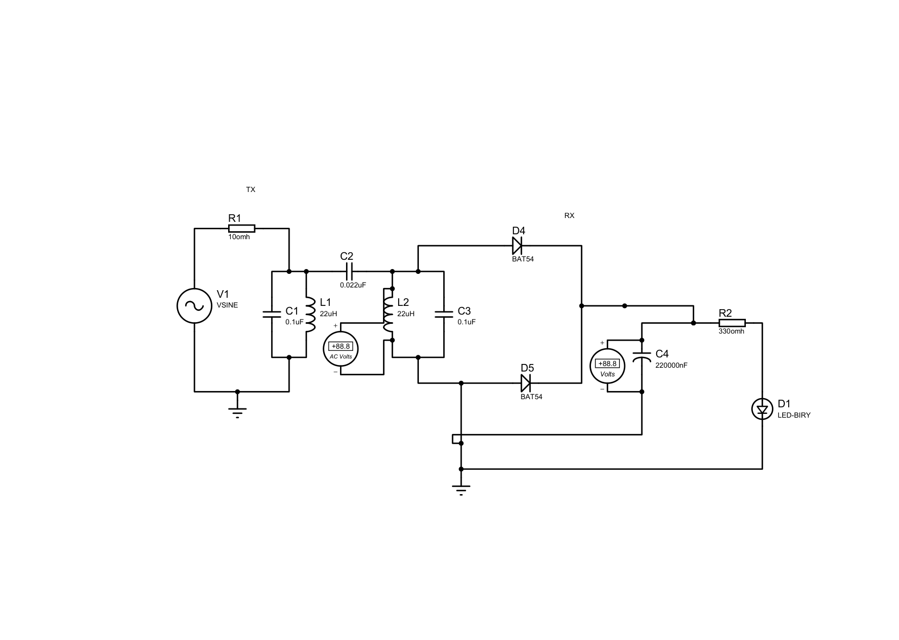

# Wireless Charger System: Inductive Power Transfer

A student project on wireless (inductive) power transfer for low-power DC loads: AC excitation, tuned transmitter and receiver stages, rectification and DC filtering.

## Circuit

[Schematic as PDF](docs/schematic.pdf) · [Proteus project](simulation/wireless-charger.pdsprj)

## Components in the simulation

| Stage | Parts |
|---|---|
| Excitation | V1 sine source, R1 10 Ω |
| Transmitter (TX) tank | L1 22 µH in parallel with C1 0.1 µF |
| Link between the stages | C2 0.022 µF and a common ground |
| Receiver (RX) tank | L2 22 µH in parallel with C3 0.1 µF |
| Rectifier | D4 and D5, BAT54 Schottky diodes |
| Filter | C4 220 µF |
| Load | R2 330 Ω and an LED |
| Measurement | AC voltmeter at the receiver, DC voltmeter at the output |

## How it works

1. The sine source drives the transmitter LC tank. On its own, each 22 µH and 0.1 µF tank resonates at about **107 kHz** (f = 1 / (2π√LC)). The other parts of the circuit shift the response of the complete network.
2. The signal reaches the receiver tank.
3. D4 passes the positive half-cycles to the output. Because the lower receiver node is grounded, the circuit behaves as a **half-wave rectifier**, and D5 limits negative excursions of the output.
4. C4 smooths the result into a DC voltage that drives the LED.

## What the simulation does and does not show

- **No magnetic coupling is modelled.** L1 and L2 are separate inductors with no mutual inductance. In the schematic, the two stages are connected through C2 and a common ground, so this simulation does not show wireless transfer through a magnetic field.
- **The load is an LED.** The schematic has no voltage regulator, charging controller or battery.

## Possible improvements

- Model L1 and L2 as coupled inductors (a transformer with a coupling coefficient below 1), and remove the conductive link between the two sides.
- Use a full-bridge rectifier on the isolated receiver coil.
- Add voltage regulation and a proper charging controller before connecting any battery.
- Record output voltage and efficiency against coil distance.

## Open the simulation

Open `simulation/wireless-charger.pdsprj` in **Proteus Design Suite** and run the simulation.

## Author

**Aman Kumar**, B.Tech in Electronics & Communication Engineering
